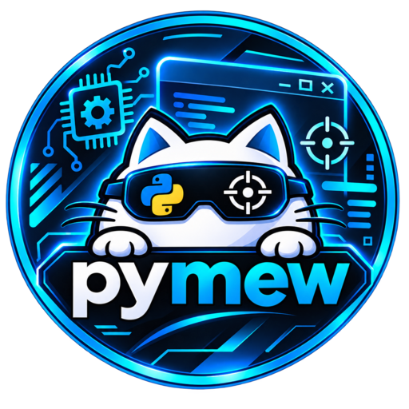

<p align="center"></p>
<h3 align="center">A cross-platform Python memory manipulation and overlay library designed to simplify the development of external game cheats</h3>

<p align="center">
  <a href="https://discord.gg/B34S4aMYqY"></a>
  <a href="CHEATSHEET.md"></a>
  
  
</p>

<p align="center">
  
  
  <a href="https://www.buymeabeer.com/quebee"></a>
</p>

## Cheatsheet / Features

An overview of the full API can be found in the **[cheatsheet](CHEATSHEET.md)** — memory, overlay, drawing, input, hotkeys and more...

## Installation

```bash
pip install pymew
```

Requires 64-bit Python 3.7 or newer.

## Quick start

```python
import pymew as pm

with pm.mem.open("game.exe") as process:
    with pm.overlay.open(target="game.exe", exit_key="end") as overlay:
        address = process.base() + 0x2A0

        while overlay.loop():
            health = process.read(address, pm.mem.i32)
            pm.draw.text(text=f"health: {health}", x=20, y=20, size=20)
```

## Compiling from source

Install [Nim](https://nim-lang.org/install.html) and Git, then:

```bash
git clone https://github.com/qb-0/pymew
cd pymew
nimble install --depsOnly -y
nim c pymew
```

## Projects
<div align="center"><sub>Want your project listed here? Open a pull request or post it on pymew's discord server.</sub></div><br>

<div align="center"><a href="https://github.com/qb-0/pymew-DS3-ESP"><strong>pymew-DS3-ESP</strong></a><br><sub>Nov 24, 2026 · <a href="https://github.com/qb-0">qb-0</a></sub><br><a href="https://github.com/qb-0/pymew-DS3-ESP"></a><br>A configurable, cross-platform Darksiders III ESP.</div><br>

<!--
Copy this block to add a project:

<div align="center"><a href="LINK"><strong>NAME</strong></a><br><sub>Mon DD, YYYY · <a href="https://github.com/AUTHOR">AUTHOR</a></sub><br><a href="LINK"></a><br>ONE LINE DESCRIPTION</div><br>
-->
